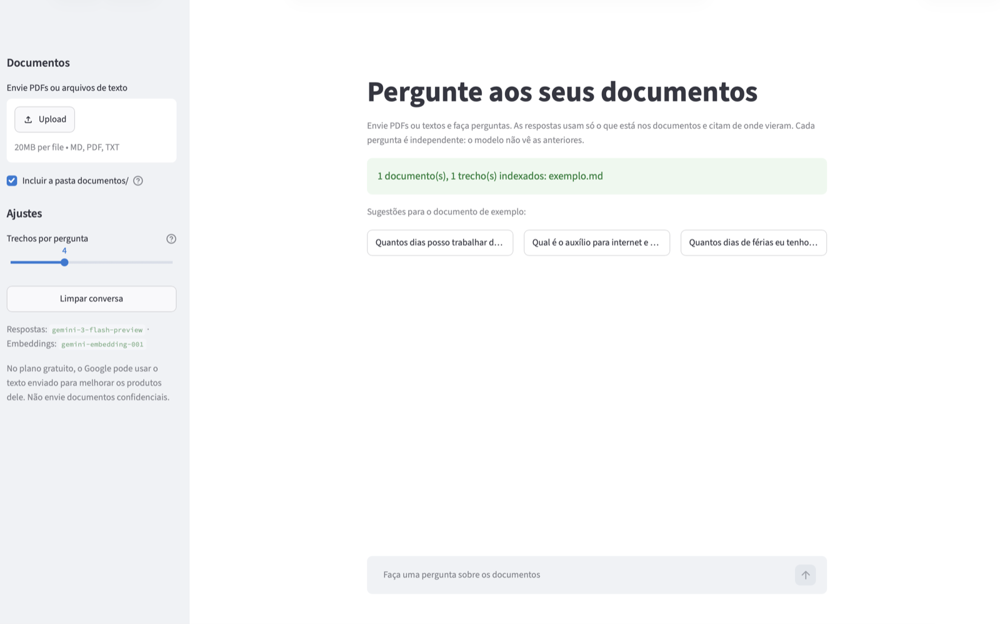
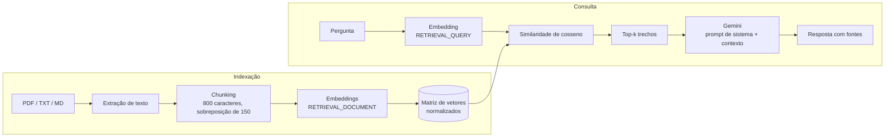

# RAG Minimalista com Gemini

**Faça perguntas sobre os seus próprios documentos e receba respostas baseadas apenas neles, com a fonte de cada informação.**

[](https://www.python.org/)
[](https://streamlit.io/)
[](https://ai.google.dev/)
[](https://rag-gemini-mini.streamlit.app/)
[](LICENSE)

Implementação enxuta de RAG (*Retrieval-Augmented Generation*) em Python: você envia PDFs ou arquivos de texto, faz uma pergunta e o Gemini responde usando **somente** os trechos relevantes desses documentos, citando de onde cada informação veio. Quando a resposta não está nos documentos, ele diz que não encontrou em vez de inventar.

Todo o pipeline (extração, chunking, embeddings, busca vetorial e geração) cabe em um único arquivo, sem frameworks de orquestração nem banco vetorial, e roda na camada gratuita da API do Gemini.

**[Teste online: rag-gemini-mini.streamlit.app](https://rag-gemini-mini.streamlit.app/)**: basta colar sua chave gratuita da API do Gemini na barra lateral, sem instalar nada.



---

## Sumário

- [Destaques](#destaques)
- [Como funciona](#como-funciona)
- [Início rápido](#início-rápido)
- [Uso](#uso)
- [Configuração](#configuração)
- [Decisões de projeto](#decisões-de-projeto)
- [Estrutura do projeto](#estrutura-do-projeto)
- [Solução de problemas](#solução-de-problemas)
- [Privacidade e custos](#privacidade-e-custos)
- [Limitações e próximos passos](#limitações-e-próximos-passos)
- [Licença](#licença)

---

## Destaques

- **Respostas com fontes:** cada resposta cita o trecho de origem (`arquivo#trecho`), e a interface mostra o texto recuperado e sua similaridade com a pergunta.
- **Sem invenção por padrão:** o prompt de sistema restringe o modelo ao contexto recuperado; perguntas fora dos documentos recebem uma recusa explícita.
- **PDF, TXT e Markdown:** extração com `pypdf`, com avisos claros para PDFs digitalizados, protegidos por senha ou corrompidos.
- **Duas interfaces, um pipeline:** interface web em Streamlit (upload e conversa) e modo terminal, ambos sobre as mesmas funções.
- **Sem banco vetorial:** a busca é um produto escalar em NumPy, suficiente para milhares de trechos em milissegundos.
- **Leve e portável:** sem PyTorch nem modelo local; os embeddings vêm da API do Gemini.

## Como funciona



1. **Indexação:** os documentos são divididos em trechos (*chunks*) com sobreposição, e cada trecho vira um vetor (*embedding*) que representa seu significado.
2. **Recuperação:** a pergunta também vira um vetor, e os trechos mais próximos dela são selecionados.
3. **Geração:** o Gemini recebe a pergunta e os trechos selecionados, e responde com base apenas neles.

## Início rápido

**Pré-requisitos:** Python 3.10+ e uma chave gratuita da API do Gemini ([como obter](#chave-da-api-do-gemini)).

```bash
git clone https://github.com/cavalcantiraissas/rag-gemini-minimalista.git
cd rag-gemini-minimalista

python3 -m venv .venv
source .venv/bin/activate          # Windows: .venv\Scripts\Activate.ps1
pip install -r requirements.txt

export GEMINI_API_KEY="sua-chave"  # Windows: $env:GEMINI_API_KEY="sua-chave"
streamlit run app.py
```

A interface abre em http://localhost:8501.

<details>
<summary>Primeira vez usando Python ou o terminal? Veja o passo a passo detalhado.</summary>

**Abrir o terminal**
- **macOS:** `Cmd + Espaço`, digite "Terminal" e aperte Enter.
- **Windows:** tecla Windows, digite "PowerShell" e aperte Enter.
- **Linux:** normalmente `Ctrl + Alt + T`.

**Verificar o Python:** rode `python3 --version` (no Windows, `python --version`). Se não aparecer `Python 3.10` ou superior, instale pelo [python.org/downloads](https://www.python.org/downloads/).

**Baixar sem Git:** na página do repositório, clique em **Code → Download ZIP**, descompacte e entre na pasta com `cd caminho/para/rag-gemini-minimalista`.

**Ambiente virtual:** é uma pasta isolada para as bibliotecas do projeto. Depois de ativado, o terminal mostra `(.venv)` no início da linha. Em cada terminal novo, rode de novo só a linha de ativação.

**Deixar a chave salva** (para não precisar exportar a cada terminal):

```bash
# macOS (zsh); no Linux, troque ~/.zshrc por ~/.bashrc
echo 'export GEMINI_API_KEY="sua-chave"' >> ~/.zshrc
source ~/.zshrc
```

```powershell
# Windows: feche e abra o terminal depois
setx GEMINI_API_KEY "sua-chave"
```

Para conferir: `echo $GEMINI_API_KEY` (macOS/Linux) ou `echo $env:GEMINI_API_KEY` (Windows).

</details>

### Chave da API do Gemini

1. Acesse [aistudio.google.com](https://aistudio.google.com) e entre com uma conta Google.
2. Clique em **Get API key → Create API key** e copie a chave (começa com `AIza...`).

A chave é gratuita e não exige cartão de crédito. Ela é lida da variável de ambiente `GEMINI_API_KEY`; nunca a escreva no código nem a publique. Se ela vazar, apague-a no AI Studio e gere outra.

## Uso

### Interface web

```bash
streamlit run app.py
```

- **Documentos:** arraste arquivos `.pdf`, `.txt` ou `.md` para a barra lateral (até 20 MB cada) ou use a pasta `documentos/`, que já traz um exemplo de política de home office. Ao enviar o primeiro arquivo, a pasta deixa de ser incluída automaticamente; marque a opção de novo se quiser os dois.
- **Perguntas:** use a caixa de conversa ou um dos botões de sugestão.
- **Fontes:** em cada resposta, **Trechos recuperados** mostra os trechos usados e a similaridade de cada um (0 a 1).
- **Trechos por pergunta:** controla quantos trechos são enviados ao Gemini.
- **Chave:** se `GEMINI_API_KEY` não estiver definida, a interface pede a chave na barra lateral. Ela vale só para aquela sessão e não é salva.

Os embeddings ficam em cache enquanto o servidor estiver rodando: novas perguntas ou ajustes não reprocessam os documentos.

### Terminal

Coloque os arquivos na pasta `documentos/` (subpastas incluídas) e rode:

```text
$ python rag.py

Carregando documentos de '.../documentos'...
1 documento(s), 1 chunk(s).
Gerando embeddings com 'gemini-embedding-001'...

Pronto! Faça sua pergunta (ou digite 'sair' para encerrar).

Pergunta> Quantos dias posso trabalhar de casa e qual o auxílio que recebo?

Chunks recuperados:
  - exemplo.md#0  (similaridade: 0.752)

Resposta:
Você pode trabalhar remotamente até 3 dias por semana e o auxílio recebido
é de R$ 150,00 mensais para custear despesas de internet e energia.

Fonte: [exemplo.md#0]

Pergunta> Quantos dias de férias eu tenho por ano?

Chunks recuperados:
  - exemplo.md#0  (similaridade: 0.646)

Resposta:
Não encontrei essa informação nos documentos fornecidos.
```

Na segunda pergunta, o modelo **não inventa** uma resposta: o documento não fala de férias.

### Boas práticas

- Perguntas específicas, sobre um assunto só, recuperam trechos melhores do que perguntas amplas como "me fale tudo".
- Se uma resposta vier errada, confira primeiro os trechos recuperados: geralmente o problema é o trecho certo não ter sido encontrado. Aumentar o número de trechos costuma resolver.
- Para testar a fidelidade aos documentos, pergunte algo que não está neles (por exemplo, "Qual é o salário inicial?").

## Configuração

**Variáveis de ambiente**

| Variável | Descrição | Padrão |
|---|---|---|
| `GEMINI_API_KEY` | Chave da API (obrigatória; `GOOGLE_API_KEY` também é aceita) | — |
| `GEMINI_MODEL` | Modelo que gera as respostas | `gemini-3-flash-preview` |
| `GEMINI_EMBEDDING_MODEL` | Modelo de embeddings | `gemini-embedding-001` |

Os modelos disponíveis na camada gratuita mudam com o tempo; consulte [ai.google.dev/pricing](https://ai.google.dev/pricing).

**Constantes em [`rag.py`](rag.py)**

| Constante | Descrição | Padrão | Quando ajustar |
|---|---|---|---|
| `CHUNK_SIZE` | Tamanho máximo de cada trecho, em caracteres | 800 | Respostas que precisam de mais contexto contínuo |
| `CHUNK_OVERLAP` | Sobreposição entre trechos consecutivos | 150 | Informações sendo cortadas entre trechos |
| `TOP_K` | Trechos enviados ao modelo (valor inicial na interface web) | 4 | Perguntas que combinam informações de vários lugares |
| `SYSTEM_PROMPT` | Instruções dadas ao modelo | — | Mudar idioma, tom ou formato das respostas |

## Decisões de projeto

- **Sem banco vetorial.** Com vetores normalizados, a similaridade de cosseno vira um produto escalar (`embeddings @ query`). Para milhares de trechos isso roda em milissegundos; FAISS, Chroma e similares adicionariam complexidade sem ganho nessa escala.
- **Embeddings via API.** Dispensa PyTorch (cerca de 1 GB) e funciona em qualquer máquina, inclusive Macs Intel. O `task_type` assimétrico (`RETRIEVAL_DOCUMENT` para trechos, `RETRIEVAL_QUERY` para perguntas) melhora a recuperação.
- **Chunking por caracteres com cortes naturais.** Não depende de tokenizer. O corte procura, na segunda metade da janela, um separador na ordem `\n\n` → `\n` → `. ` → espaço, para não partir frases.
- **Contexto em tags XML.** `<contexto>` e `<trecho fonte="...">` separam o material de referência da pergunta e permitem que o modelo cite as fontes.
- **Interfaces finas sobre o mesmo núcleo.** `app.py` só cuida da tela; toda a lógica está em `rag.py`. O índice da interface web fica em cache (`st.cache_data`) pelo conteúdo dos documentos.
- **Erros tratados por categoria.** `ErroDeConfiguracao` para problemas de ambiente; `ErroDeArquivo` para arquivos ilegíveis, que são pulados sem interromper os demais; erros da API traduzidos por status HTTP (401/403, 404, 429, 5xx) em mensagens com a ação a tomar.

## Estrutura do projeto

```text
rag-gemini-minimalista/
├── rag.py              # pipeline RAG e interface de terminal
├── app.py              # interface web (Streamlit)
├── requirements.txt    # google-genai, numpy, pypdf, streamlit
├── .streamlit/
│   └── config.toml     # tema e limite de upload
└── documentos/         # arquivos .pdf, .txt e .md usados pelo terminal
    └── exemplo.md
```

| Função (`rag.py`) | Responsabilidade |
|---|---|
| `extrair_texto` | Extrai texto de `.txt`/`.md` (UTF-8) ou `.pdf` (pypdf) a partir dos bytes |
| `carregar_documentos` | Lê os arquivos suportados da pasta, recursivamente |
| `dividir_em_chunks` / `gerar_chunks` | Chunking com sobreposição, preservando arquivo e índice de origem |
| `gerar_embeddings` | Chamadas em lote à API de embeddings e normalização L2 |
| `criar_indice` / `buscar` | Índice em memória e busca top-k por cosseno |
| `montar_contexto` | Formata os trechos recuperados para o prompt |
| `perguntar_ao_gemini` | Chamada ao modelo com prompt de sistema; trata respostas bloqueadas |
| `descrever_erro_api` | Converte erros da API em mensagens acionáveis |
| `loop_interativo` / `main` | Interface de terminal e códigos de saída |

## Solução de problemas

| Mensagem ou sintoma | Causa provável | Solução |
|---|---|---|
| `ModuleNotFoundError` ou `command not found: streamlit` | Dependências ausentes ou ambiente virtual inativo | Ative o `.venv` e rode `pip install -r requirements.txt` |
| `command not found: python` | O comando no seu sistema é `python3` | Use `python3` ou ative o `.venv` |
| `Variável GEMINI_API_KEY não definida` | Chave não configurada neste terminal | Veja [Chave da API do Gemini](#chave-da-api-do-gemini) |
| `Chave de API inválida ou sem permissão` | Chave copiada errada ou apagada | Copie de novo no AI Studio, sem espaços extras |
| `Limite da camada gratuita atingido` | Muitas requisições em pouco tempo | Aguarde um minuto e tente de novo |
| `Modelo não encontrado` | Modelo renomeado ou desativado pelo Google | Defina `GEMINI_MODEL` com um modelo atual |
| `não tem texto selecionável` | PDF digitalizado (imagem das páginas) | Aplique OCR antes ou copie o texto para um `.txt` |
| `é protegido por senha` | PDF com senha de abertura | Salve uma cópia sem senha |
| `não está em UTF-8` | Arquivo de texto em outra codificação | Salve o arquivo como UTF-8 no editor |
| A resposta ignora algo que está no documento | O trecho certo não foi recuperado | Confira os trechos recuperados e aumente `TOP_K` |

## Privacidade e custos

- **Custo:** usa apenas a camada gratuita da API do Gemini, que tem limites por minuto e por dia. Cada pergunta faz duas chamadas (embedding e resposta); a indexação faz chamadas extras, em lotes de 100 trechos.
- **Privacidade:** o texto dos documentos é enviado ao Google. **No plano gratuito, o Google pode usar esses dados para melhorar os produtos dele.** Não use documentos confidenciais nem dados pessoais; para isso, considere o plano pago ou um modelo local.
- **Armazenamento:** nada é gravado em disco. Arquivos enviados, texto extraído e embeddings ficam só em memória e são descartados ao encerrar o programa.

## Limitações e próximos passos

**Limitações conhecidas**

- No terminal, o índice é refeito a cada execução; na interface web, o cache dura enquanto o servidor estiver rodando.
- Cada pergunta é independente: a interface mostra o histórico, mas o modelo não o recebe.
- PDFs digitalizados não são lidos (não há OCR), e PDFs com colunas ou tabelas podem ter o texto extraído fora de ordem.
- As fontes citam arquivo e trecho, não a página do PDF.
- Não há limiar mínimo de similaridade: os `TOP_K` trechos são sempre enviados, e o prompt de sistema orienta o modelo a recusar quando o contexto não responde.

**Próximos passos**

- [ ] Persistir os embeddings e reprocessar só os arquivos alterados (hash do conteúdo).
- [ ] OCR para PDFs digitalizados e citação da página de origem.
- [ ] Limiar de similaridade mínima e *reranking*.
- [ ] Histórico de conversa para perguntas de acompanhamento.
- [ ] Conjunto de avaliação (perguntas e respostas esperadas) para ajustar `CHUNK_SIZE` e `TOP_K` com métricas.

## Licença

Distribuído sob a licença MIT. Veja [LICENSE](LICENSE).
